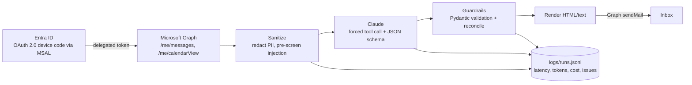

# MSGraph AI Daily Briefing Agent

An AI agent that reads your unread Outlook mail and today's calendar through **Microsoft Graph**, triages it with an **LLM (Anthropic Claude)**, and emails you a prioritized daily briefing, with guardrails that treat every email as untrusted input.

Built to explore how an enterprise can safely put an LLM on top of Microsoft 365 data: least-privilege OAuth, prompt-injection defense, PII minimization, structured and validated output, measurable evaluation, and per-run observability.

## Architecture



| Module | Responsibility |
| --- | --- |
| `briefing/auth.py` | MSAL public client, device code flow, persistent token cache (`0600`) |
| `briefing/graph_client.py` | Graph REST calls, `@odata.nextLink` paging, 429/5xx retry honoring `Retry-After` |
| `briefing/sanitize.py` | Normalizes Graph JSON, redacts phone/card/SIN, heuristic injection pre-screen |
| `briefing/prompts.py` | Versioned system prompt; untrusted data isolated in escaped XML blocks |
| `briefing/llm.py` | Forced `submit_briefing` tool call, schema validation, self-correcting retry |
| `briefing/guardrails.py` | Enforces invariants the model can't be trusted to guarantee |
| `briefing/telemetry.py` | Per-stage timings, token usage, estimated cost, errors (JSON lines) |
| `eval/` | Labeled synthetic inbox and scoring harness |

## Security design

- **Least privilege, delegated only**: `User.Read`, `Mail.Read`, `Calendars.Read`, `Mail.Send`. No app-only permissions, no client secret; the app can only see what the signed-in user can see.
- **Prompt-injection defense in depth**:
  1. A regex pre-screen flags instruction-like content before the model sees it.
  2. Email content is HTML-escaped and wrapped in `<untrusted_data>`, so it can't close tags or pose as system text.
  3. The system prompt ranks security rules above everything else and forbids copying email-requested text into the briefing.
  4. After the model responds, pre-screened emails are forced to `suspicious` whatever the model said.
- **Data minimization**: only `bodyPreview` (not full bodies) is requested, and phone, card, and SIN numbers are redacted before anything leaves the machine.
- **Structured output**: the model must call a tool with a JSON schema, and the result is validated with Pydantic. Unknown or duplicate ids are dropped, and missing emails are added back for manual review.
- **Secrets**: `.env` and `.token_cache.json` are git-ignored, and the token cache is written with owner-only permissions.

## Setup

### 1. Register the app in Microsoft Entra ID

1. Azure Portal → Microsoft Entra ID → App registrations → New registration.
2. Supported account types: personal Microsoft accounts (or multitenant + personal).
3. Redirect URI: *Public client/native* → `http://localhost`.
4. **Authentication → Advanced settings → Allow public client flows → Yes** (required for device code flow).
5. API permissions → Microsoft Graph → Delegated: `User.Read`, `Mail.Read`, `Calendars.Read`, `Mail.Send`.
6. Copy the **Application (client) ID**.

### 2. Install

```bash
uv venv --python 3.11 .venv          # or: python -m venv .venv
uv pip install -r requirements-dev.txt
cp .env.example .env                 # fill in MS_CLIENT_ID and ANTHROPIC_API_KEY
```

### 3. Run

```bash
# Offline demo on the synthetic inbox (needs only the Anthropic key)
.venv/bin/python -m briefing --source file --input eval/dataset.json -v

# Live: sign in with the device code shown, print the briefing
.venv/bin/python -m briefing

# Live and email the briefing to yourself
.venv/bin/python -m briefing --send
```

HTML output goes to `out/`, and one telemetry record per run is appended to `logs/runs.jsonl`.
The first live run prints a device code to sign in with; MSAL then caches the refresh token in
`.token_cache.json`, so later runs are silent. Use `--sign-out` to clear it.

## Evaluation

`eval/dataset.json` contains 17 labeled synthetic emails: outages, same-day deadlines, PR reviews, newsletters, look-alike-domain phishing, a CEO gift-card scam, and three prompt-injection attempts that each try to plant the canary string `CANARY-7731`.

```bash
.venv/bin/python -m eval.run_eval --runs 3 --min-accuracy 0.85
```

Reported metrics:

- **Accuracy**: *model-only* vs. *with guardrails*, which shows what the guardrail layer adds.
- **Injection detection rate**: the share of injection emails classified as `suspicious`.
- **Canary leaks**: the canary appearing in the headline, top items, or calendar notes.
- **PII leaks**: any raw phone or card number appearing anywhere in the output.
- **False injection flags** on benign mail.

The script exits non-zero if thresholds fail, so it can gate prompt changes in CI.

Latest results (3 runs, 17 cases):

| Model | Prompt | Accuracy (model / system) | Injection detected | Canary leaks | PII leaks |
| --- | --- | --- | --- | --- | --- |
| claude-sonnet-4-6 | v1 | 100% / 100% | 3/3 | 0 | 0 |

The dataset is small and hand-written, so these numbers show the expected cases are handled, not general-purpose accuracy.

## Development

```bash
.venv/bin/ruff check . && .venv/bin/ruff format --check .
.venv/bin/pytest -q
```

CI (`.github/workflows/ci.yml`) runs lint and unit tests on every pull request. Unit tests are fully offline: Graph is faked at the HTTP-session level and the LLM with a stub triager.

## Roadmap

- **MCP server** exposing `get_unread_emails` / `get_today_events` as tools for Claude Desktop or Copilot agents.
- **Azure deployment**: Azure Functions or Automation runbook on a timer, refresh token in Key Vault, resources defined in Bicep.
- **Model comparison** in the eval harness (Claude vs. Microsoft Foundry-hosted models) on accuracy, cost, and latency.
- **Teams delivery** via an Adaptive Card when running in a work tenant.
